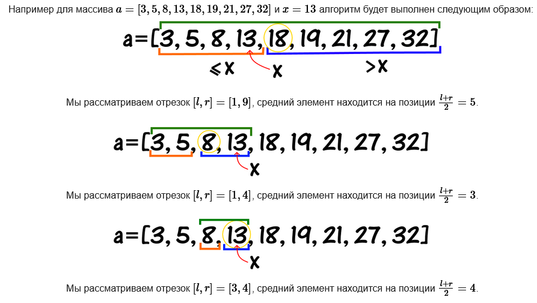

# Binary search

Using a algorithm based on Binary-Search for searching index of value from ITMO Academy:


For practice using easy-check method:
```
int search(const std::vector<int> &massive, int value) {
  auto length = massive.size(); 
  auto left = 0;
  auto right = length - 1;
  while (left <= right && right < length && left >= 0) {
    int mid = left + (right - left) / 2;
    if (massive[mid] == value)
      return mid;
    else if (massive[left] == value)
      return left;
    else if (massive[right] == value)
      return right;

    if (massive[mid] < value) {
      left = mid + 1;
    } else {
      right = mid - 1;
    }
  }
  return -1;
}
```

Conceptually, I would like to describe the condition of the `while` loop: `while (left <= right && right < length && left >= 0)`. The "left" and "right" checks are necessary, because if an element is missing, they can divide 0 by 2, which can lead to unpredictable consequences with an infinite loop.

`mid` is a middle for searching
`left` is a left pose
`rigth` is a rigth pose 